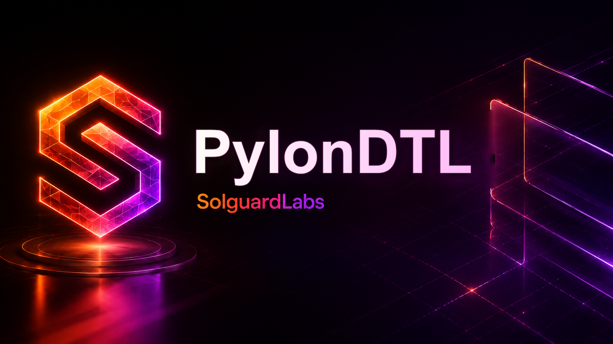

# PylonDTL



PylonDTL es un motor C++ de limites de riesgo para infraestructura de
settlement. Modela operadores, assets, canales de liquidacion y sesiones de
ejecucion con cuotas dinamicas recalculadas por epoch.

El proyecto expone un binario CLI que genera reportes JSON deterministas para
escenarios de auditoria. La superficie esta pensada para revisar reglas de
admision, accounting de fees y reservas, conservacion por asset y transiciones
operativas entre epochs.

## Componentes

- `PolicyBook`: catalogo de operadores, assets, canales y politicas de limite.
- `RiskEngine`: orquesta sesiones, admision de ordenes, ejecucion y cambios de
  epoch.
- `LedgerBook`: conserva balances por cuenta y asset con movimientos auditables.
- `ExposureBook`: agrega exposicion por operador, asset, canal y politica.
- `ScenarioRunner`: escenarios reproducibles para snapshots, flujos simples,
  cambios de epoch, carteras multioperador y canales mixtos.
- `ScriptRunner`: DSL minima para reproducir operaciones externas.

## Requisitos

- Node.js 20 o superior.
- Compilador C++17: Visual Studio Build Tools, GCC o Clang.

## Uso

```bash
node scripts/build.mjs
dist/pylon-dtl snapshot
dist/pylon-dtl single
dist/pylon-dtl epoch
dist/pylon-dtl portfolio
dist/pylon-dtl channels
dist/pylon-dtl script examples/steady-flow.pylon
```

En Windows, el binario se genera como `dist/pylon-dtl.exe`.

## Tests

```bash
node scripts/build.mjs
node --test --test-concurrency=1 "tests/node/*.test.js"
```

Tambien se puede ejecutar:

```bash
bash scripts/tests.sh
bash scripts/ci.sh
```

## DSL De Scripts

Los scripts aceptan comandos simples, uno por linea:

```text
SCENARIO steady-script
OPEN ses-script atlas USDC rtgs atlas-funding balanced
ORDER ord-script ses-script atlas USDC rtgs atlas-funding beneficiary-a 150000000 150000000 10 5
QUOTE atlas USDC rtgs 75000000 10
NOTE scripted rtgs settlement completed
```

## Estructura

```text
src/
  pylon.hpp
  amount.cpp
  domain.cpp
  ledger.cpp
  policy.cpp
  session.cpp
  engine.cpp
  scenario.cpp
  script.cpp
  report.cpp
  analytics.cpp
  reconciliation.cpp
  cli.cpp
  main.cpp
tests/
  helpers/
  node/
scripts/
  build.mjs
  tests.sh
  ci.sh
```

## CI

La validacion local y GitHub Actions ejecutan:

1. comprobacion de formato basica;
2. build C++17;
3. tests de integracion con `node:test`.

## Estado

PylonDTL es un laboratorio autocontenido. No requiere servicios externos ni
credenciales para compilar, ejecutar escenarios o validar la suite.
