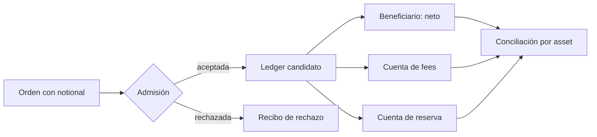
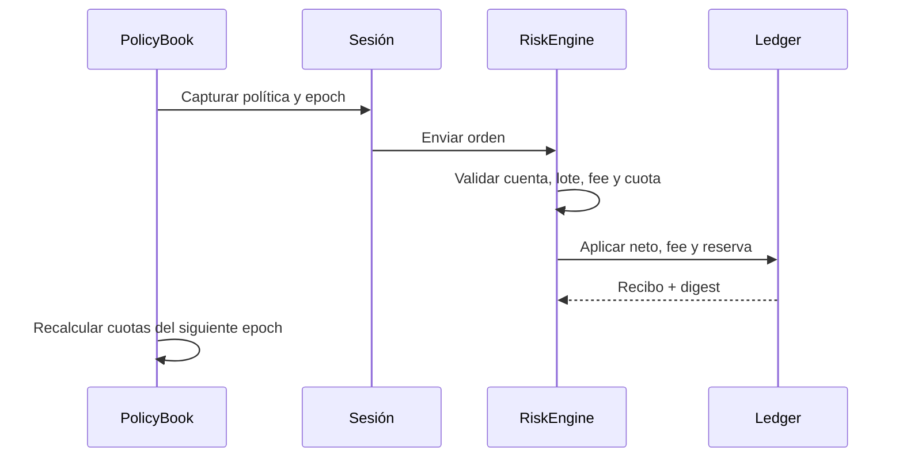

# PylonDTL


PylonDTL es un motor C++ de limites de riesgo para infraestructura de
settlement. Modela operadores, assets, canales de liquidacion y sesiones de
ejecucion con cuotas dinamicas recalculadas por epoch.

El proyecto expone un binario CLI que genera reportes JSON deterministas para
escenarios de auditoria. La superficie esta pensada para revisar reglas de
admision, accounting de fees y reservas, conservacion por asset y transiciones
operativas entre epochs.

## Modelo de valor



Para una orden RTGS de 400.000.000 unidades de USDC, un fee de 4 bps y una
reserva de 150 bps producen 160.000 unidades de fee, 6.000.000 de reserva y
393.840.000 para el beneficiario. La suma de las tres salidas reproduce el
notional. La transferencia de las tres partidas se confirma como una unidad
en el ledger en memoria.

## Cuotas y epochs



Los reportes separan cuota publicada, exposición agregada, consumos de sesión
y recibos. Esas vistas tienen cortes temporales distintos; para decisiones
externas de crédito deben revisarse conjuntamente con la política vigente.

## Componentes

- `PolicyBook`: catalogo de operadores, assets, canales y politicas de limite.
- `RiskEngine`: orquesta sesiones, admision de ordenes, ejecucion y cambios de
  epoch.
- `LedgerBook`: conserva balances por cuenta y asset con movimientos auditables.
- `ExposureBook`: agrega exposicion por operador, asset, canal y politica.
- `ScenarioRunner`: escenarios reproducibles para snapshots, flujos simples,
  cambios de epoch, carteras multioperador y canales mixtos.
- `ScriptRunner`: DSL minima para reproducir operaciones externas.
- Parser de cantidades con rechazo explícito de enteros fuera de rango y
  cotizaciones con suma comprobada de notional y reserva.
- Asignación atómica de neto, fee y reserva en el ledger candidato.

## Documentación

- [Protocolo operativo](docs/PROTOCOL.md): dominios de riesgo y liquidación.
- [Modelo económico](docs/ECONOMICS.md): pesos, cuotas, fees y reservas.
- [Guía de scripting](docs/SCRIPTING.md): comandos y ejemplos.
- [Operación](docs/OPERATIONS.md): conciliación, métricas y releases.
- [Seguridad operativa](docs/SECURITY_OPERATIONS.md): fronteras de confianza
  y respuesta a incidentes.

## Requisitos

- Node.js 20 o superior.
- Compilador C++17: Visual Studio Build Tools, GCC o Clang.

## Uso

```bash
node scripts/build.mjs
dist/pylon-dtl snapshot
dist/pylon-dtl single
dist/pylon-dtl epoch
dist/pylon-dtl portfolio
dist/pylon-dtl channels
dist/pylon-dtl script examples/steady-flow.pylon
```

En Windows, el binario se genera como `dist/pylon-dtl.exe`.

## Tests

```bash
node scripts/build.mjs
node --test --test-concurrency=1 "tests/node/*.test.js"
```

Tambien se puede ejecutar:

```bash
bash scripts/tests.sh
bash scripts/ci.sh
```

## DSL De Scripts

Los scripts aceptan comandos simples, uno por linea:

```text
SCENARIO steady-script
OPEN ses-script atlas USDC rtgs atlas-funding balanced
ORDER ord-script ses-script atlas USDC rtgs atlas-funding beneficiary-a 150000000 150000000 10 5
QUOTE atlas USDC rtgs 75000000 10
NOTE scripted rtgs settlement completed
```

## Estructura

```text
src/
  pylon.hpp
  amount.cpp
  domain.cpp
  ledger.cpp
  policy.cpp
  session.cpp
  engine.cpp
  scenario.cpp
  script.cpp
  report.cpp
  analytics.cpp
  reconciliation.cpp
  cli.cpp
  main.cpp
tests/
  helpers/
  node/
scripts/
  build.mjs
  tests.sh
  ci.sh
```

## CI

La validacion local y GitHub Actions ejecutan:

1. comprobacion de formato basica;
2. build C++17;
3. tests de integracion con `node:test`.

## Alcance de la distribución

PylonDTL no integra custodios, credenciales ni redes de liquidación externas.
El binario ejecuta escenarios locales reproducibles; conectores, persistencia
duradera y aprobación de riesgo pertenecen al servicio que lo incorpore. El
release identifica una versión del motor, no un despliegue sobre fondos de
terceros.
