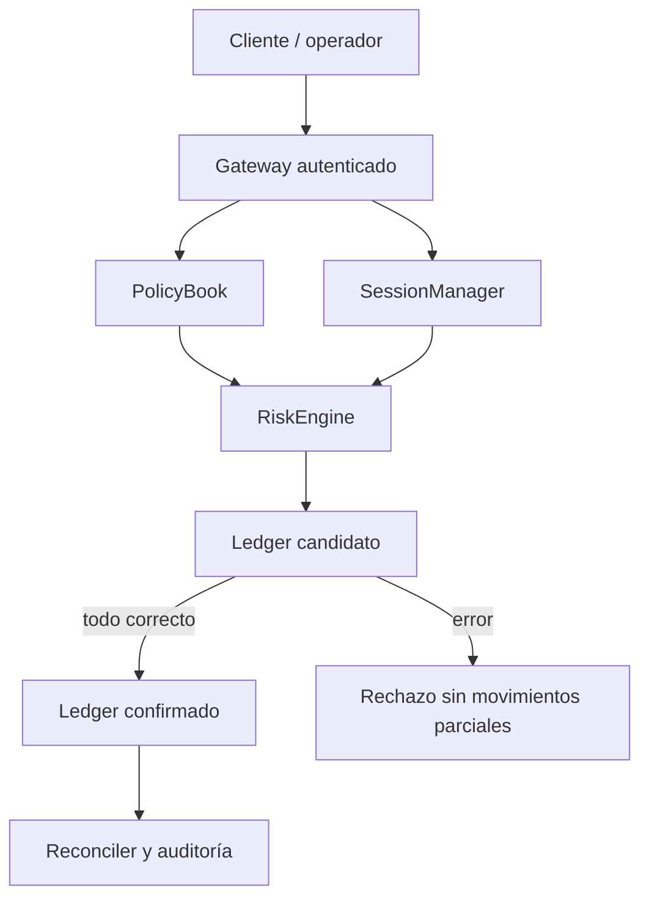

# Security Policy

## Modelo De Seguridad

PylonDTL asume que operadores, assets y canales de settlement se registran en
un catalogo administrado. Las politicas de limite se aplican por combinacion de
operador, asset y canal, y el motor mantiene exposicion agregada para reportes
de control.

Las sesiones de ejecucion representan ventanas operativas autorizadas por el
motor. Cada orden debe estar vinculada a una sesion, coincidir con el operador,
asset y canal autorizados, respetar el envelope de fees y conservar balances por
asset en el ledger.

## Invariantes Esperadas

- Los balances por asset se conservan entre cuentas internas.
- Las ordenes aceptadas producen un recibo determinista.
- La suma `net_amount + fee + reserve` coincide con el notional liquidado.
- Las sesiones agregan notional y reserva de sus recibos liquidados.
- Las politicas deshabilitadas no admiten nuevas sesiones operativas.
- Las cuotas visibles se recalculan en cada cambio de epoch.
- Notional, fee y reserva se calculan con controles de rango antes de
  confirmar movimientos.
- El ledger no conserva transferencias parciales de una orden rechazada.

## Validaciones Automatizadas

La suite en `tests/node/` ejecuta el binario compilado y verifica:

- catalogo inicial de operadores, assets, canales y politicas;
- accounting de fees, reservas y beneficiarios;
- conservacion por asset;
- reportes de exposicion por dominio;
- transicion de epoch;
- ejecucion de scripts reproducibles.

## Dependencias

El proyecto no usa librerias C++ externas. Node.js se usa para build/test
orquestados y los workflows de GitHub Actions. Dependabot esta configurado para
GitHub Actions y npm.

## Alcance De Revision

El alcance principal cubre:

- `src/`: motor C++, CLI, parser, reportes e invariantes;
- `tests/`: tests de integracion;
- `scripts/`: build y validacion local;
- documentacion publica y configuracion de CI.

Quedan fuera de alcance integraciones con custodios reales, conectores de red,
credenciales, llaves privadas y servicios de settlement externos.

La conservación por asset prueba que no se crea ni destruye valor en el libro.
No sustituye la revisión de exposición por política, sesión y epoch, ni la
aprobación humana de límites para un conector externo.

## Formato De Reporte Interno

Los reportes deben incluir:

- escenario afectado;
- pasos de reproduccion;
- impacto economico;
- cuentas, assets, operadores y canales involucrados;
- recibos o digests relevantes;
- recomendacion de remediacion;
- test de regresion propuesto.
