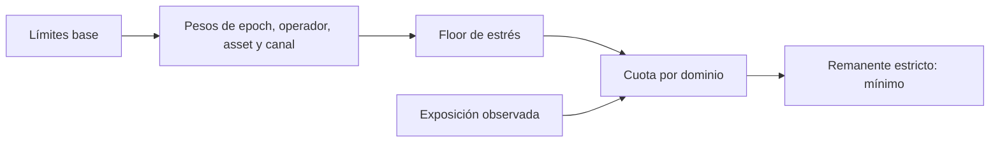

# Modelo económico y cuotas

PylonDTL representa importes como enteros de 64 bits. Cada asset conserva su
propia unidad base y precisión de presentación. No hay conversión automática
de valor entre assets; las exposiciones y saldos deben interpretarse junto con
su identificador de asset.

## Política y cuota publicada

`PolicyKey = operador:asset:canal`. Cada política define límites base por
operador, asset, canal y global, además de mínimos/máximos por orden, fee,
reserva y un floor de estrés. El cálculo de `QuotaState` aplica en orden:

```text
base
× bias_riesgo_epoch / 10_000
× bias_liquidez_epoch / 10_000
× bias_settlement_epoch / 10_000
× peso_sesion_operador / 10_000
× confianza_operador / 10_000
× peso_colateral_asset / 10_000
× peso_clase_canal / 10_000
× peso_latencia_canal / 10_000
× arrastre_volatilidad / 10_000
× arrastre_riesgo_canal / 10_000
```

Cada multiplicación usa `mul_bps`, con truncamiento a unidad entera. El límite
publicado para cada dominio es el mayor entre ese resultado y
`base × stress_floor_bps / 10_000`. Después se descuenta la exposición
observada del dominio correspondiente. El mínimo de los remanentes es la cuota
estricta reportada.



## Composición de una orden

```text
fee = truncar(notional × fee_bps / 10_000)
reserva = truncar(notional × reserve_bps / 10_000)
neto = notional − fee − reserva
notional = neto + fee + reserva
```

Por ejemplo, `400_000_000` unidades a 4 bps de fee y 150 bps de reserva
producen `160_000` de fee, `6_000_000` de reserva y `393_840_000` netas.
El ledger aplica las tres transferencias sobre un estado candidato y confirma
solo si todas terminan. La conservación por asset y la exposición por política
son métricas diferentes; ambas se deben revisar en reportes de riesgo.
