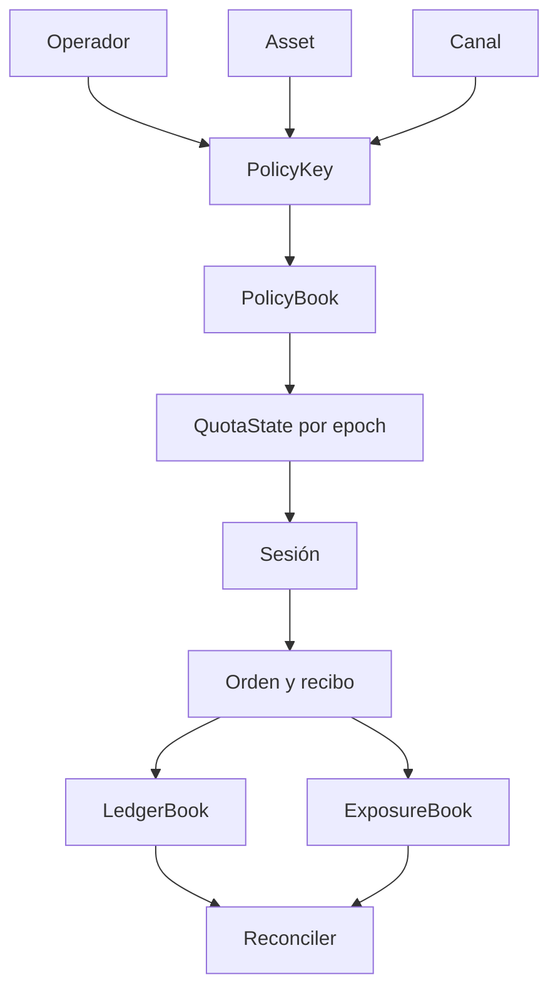

# Protocolo Operativo PylonDTL

PylonDTL organiza la ejecucion de settlement alrededor de cuatro dominios:
operadores, assets, canales y sesiones.



## Operadores

Un operador representa una entidad con capacidad de ejecutar ordenes. El perfil
incluye tier, mesa, confianza operativa y numero maximo de sesiones abiertas.
Estos factores alimentan los limites dinamicos calculados por el `PolicyBook`.

## Assets

Cada asset define decimales, lote de settlement, peso de colateral y volatilidad
operativa. La combinacion de peso y volatilidad permite normalizar limites entre
stablecoins, activos nativos y instrumentos tokenizados.

## Canales

Los canales modelan vias de settlement como RTGS, netting, L2 y custodia. Cada
canal aporta latencia, fee de settlement, floor de reserva y peso de riesgo.

## Politicas

Una politica se indexa como:

```text
operator:asset:channel
```

La politica contiene limites por operador, asset, canal y global. El limite
efectivo que se publica en reportes es el resultado de aplicar:

- sesgo de epoch;
- confianza del operador;
- peso del asset;
- clase y latencia del canal;
- floor de estres.

## Sesiones

Las sesiones agrupan ejecuciones bajo una politica concreta. La admision de una
orden comprueba:

- sesion existente y abierta;
- coincidencia de operador, asset y canal;
- notional minimo y maximo;
- envelope de fees;
- capacidad de ordenes por sesion;
- saldo suficiente en cuenta fuente;
- margen disponible dentro de la cuota aplicable.

## Ledger

El ledger mantiene balances por cuenta y asset. Una ejecucion aceptada divide el
notional en tres movimientos:

- net amount hacia el beneficiario;
- fee hacia la cuenta del canal;
- reserva hacia la cuenta de reserva del canal.

La suma de balances por asset debe conservarse durante todo el escenario.
El motor usa unidades enteras propias de cada asset; el campo `decimals` del
perfil define únicamente su presentación, no una conversión implícita entre
USDC, EURC, SOL o TBILL.
