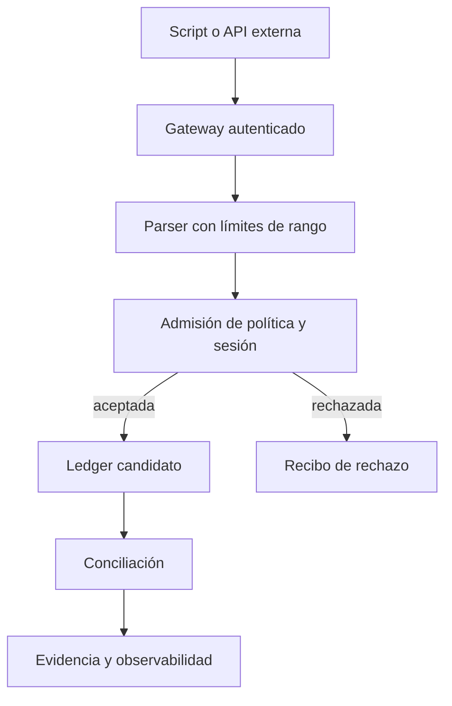

# Seguridad operativa

Los scripts y las órdenes son entrada no confiable. El motor valida
identificadores, cuentas, importes, política, estado de sesión y límites de
representación, pero no autentica personas ni habla con custodios externos.

## Controles por frontera

- **Gateway:** limitar tamaño de script, tasa por operador y acceso a
  `DEPOSIT`/`EPOCH` mediante autorización externa.
- **Parser:** rechazar números fuera del dominio de `int64` y nombres inválidos;
  conservar línea y causa del error.
- **Admisión:** verificar operador, asset, canal, cuenta fuente, fee y capacidad
  de sesión antes de modificar el ledger.
- **Ejecución:** aplicar neto, fee y reserva en un candidato; ante fallo no
  conservar movimientos parciales.
- **Conciliación:** revisar conservación por asset y exposición en relación
  con política y epoch. Una de estas vistas no sustituye a la otra.

Ante un incidente, preservar script, versión, JSON, digests y orden de las
transiciones. La remediación de límites o de destinatarios debe autorizarse en
la capa de gobierno del servicio, no mediante edición manual de recibos.
